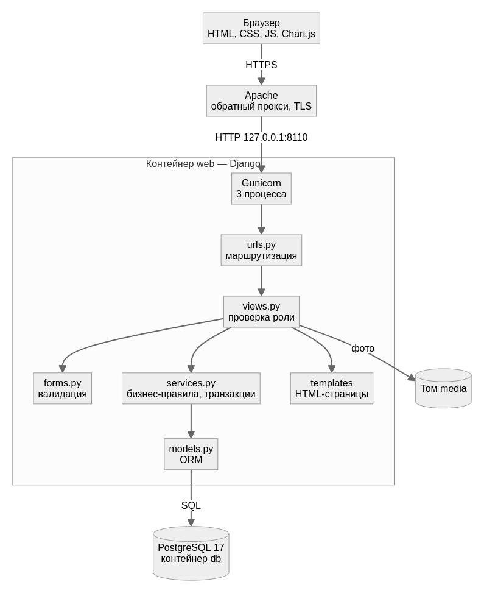
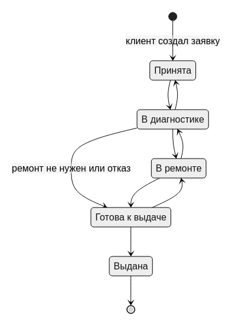

# 3. Архитектура

## 3.1. Стек

| Слой | Технология | Почему |
|---|---|---|
| Backend | Python 3.13+, Django 6.0 | Из рекомендованного стека; встроенные ORM, миграции, авторизация, формы с валидацией, защита от CSRF |
| Frontend | HTML (шаблоны Django), CSS, JavaScript | Серверный рендеринг без отдельного SPA; JS — меню, превью фото, графики |
| Графики | Chart.js 4 | Простая библиотека для столбчатых, линейных и круговых диаграмм |
| БД | PostgreSQL 17 (prod), SQLite (быстрый локальный старт и тесты) | Переключение переменной `DB_NAME` |
| Запуск | Docker Compose, Gunicorn, WhiteNoise | Одна команда для запуска; статика без отдельного веб-сервера |

## 3.2. Структура

```
config/                настройки, корневые URL
apps/
  accounts/            пользователь с ролью, регистрация, вход, профиль, декораторы ролей
  catalog/             типы устройств и услуги, публичный каталог
  repairs/             заявки, статусы, комментарии, фото, использованные запчасти
    services.py        бизнес-операции: смена статуса, списание запчастей, назначение мастера
    management/commands/seed_demo.py   демо-данные
  inventory/           склад: запчасти и журнал движений
  dashboard/           панель администратора и статистика
templates/             шаблоны страниц
static/                CSS, JS
docs/                  документация
```

Схема слоёв:



Правила, которые меняют данные сразу в нескольких таблицах (смена статуса + запись в историю, списание
запчасти + изменение остатка + журнал), вынесены в `services.py` и выполняются в транзакции. При списании
строка запчасти блокируется (`SELECT ... FOR UPDATE`), чтобы два мастера не взяли одну последнюю деталь.

## 3.3. Роли и доступ

| Раздел | Гость | Клиент | Мастер | Администратор |
|---|---|---|---|---|
| Каталог `/` | ✅ | ✅ | ✅ | ✅ |
| Проверка статуса по коду `/requests/track/<код>/` | ✅ | ✅ | ✅ | ✅ |
| Новая заявка, «Мои заявки» | — | ✅ | — | — |
| Карточка заявки | — | только свои | только назначенные | все |
| Смена статуса, запчасти, стоимость | — | — | только назначенные | все |
| Назначение мастера | — | — | — | ✅ |
| Склад: просмотр | — | — | ✅ | ✅ |
| Склад: изменение | — | — | — | ✅ |
| Панель `/manage/` | — | — | — | ✅ |

## 3.4. Схема статусов



Мастер переводит заявку только по стрелкам. Администратор может поставить любой статус (например, вернуть
выданную заявку в ремонт по гарантии). Выдать заявку без назначенного мастера нельзя. После выдачи
запчасти и стоимость работ заблокированы.

## 3.5. Маршруты

| URL | Назначение |
|---|---|
| `/` | Каталог услуг |
| `/accounts/register/`, `/accounts/login/`, `/accounts/logout/`, `/accounts/profile/` | Учётная запись |
| `/requests/new/` | Новая заявка |
| `/requests/my/` | Заявки клиента |
| `/requests/work/` | Заявки мастера |
| `/requests/<id>/` | Карточка заявки |
| `/requests/<id>/status/`, `comment/`, `parts/`, `parts/<u>/return/`, `labor/`, `assign/` | Действия (POST) |
| `/requests/<id>/photos/<p>/` | Фото с проверкой прав |
| `/requests/track/<uuid>/` | Публичный статус по коду |
| `/stock/`, `/stock/new/`, `/stock/<id>/`, `/stock/movements/` | Склад |
| `/manage/` и вложенные | Панель администратора |
| `/manage/stats.json` | Данные статистики в JSON |
| `/django-admin/` | Стандартная админка Django (резервный доступ) |

## 3.6. Развёртывание

Приложение опубликовано на https://repair.37.194.184.235.sslip.io; схема и инструкции — в
[разделе 8](08-deployment.md).

## 3.7. Макеты интерфейса

Макеты в Figma — ⏳ (задача практики). До их появления ориентиром служат скриншоты реализованных страниц в
[руководстве пользователя](06-user-guide.md).
