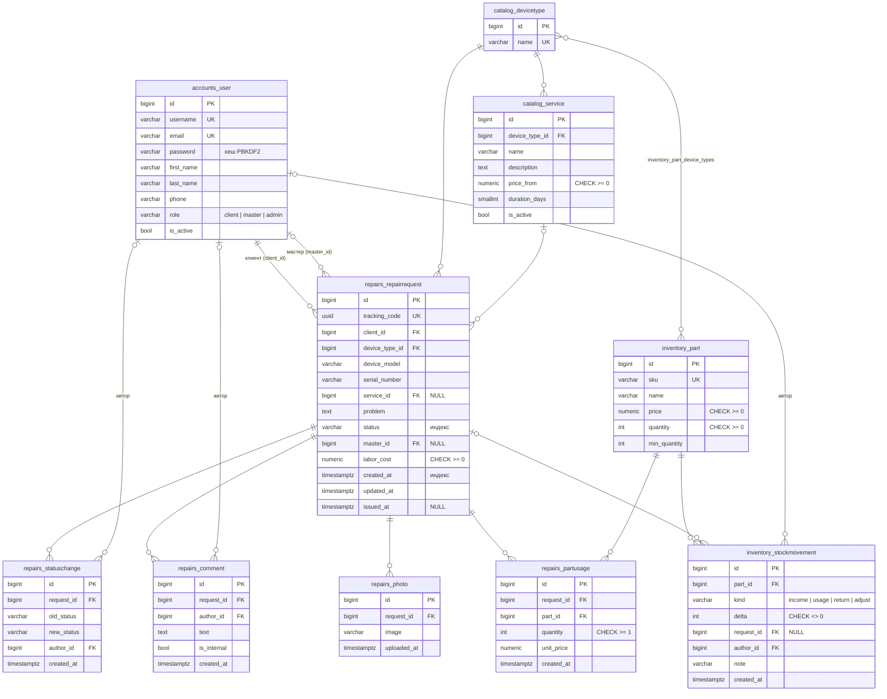

# 4. База данных

СУБД — PostgreSQL 17. Схема создаётся миграциями Django (`python manage.py migrate`).

## 4.1. ER-диаграмма

## 4.2. Таблицы

| Таблица | Назначение |
|---|---|
| `accounts_user` | Пользователи всех ролей. Расширяет стандартного пользователя Django полями `role`, `phone`; `email` уникален |
| `catalog_devicetype` | Справочник типов устройств |
| `catalog_service` | Услуги прайса с ценой «от» и сроком |
| `repairs_repairrequest` | Заявки на ремонт — центральная таблица |
| `repairs_statuschange` | Журнал смены статусов (аудит: кто и когда) |
| `repairs_comment` | Комментарии к заявке; `is_internal` скрывает комментарий от клиента |
| `repairs_photo` | Фото устройства, файл хранится на диске, в БД — путь |
| `repairs_partusage` | Запчасти, использованные в ремонте; цена фиксируется на момент списания |
| `inventory_part` | Запчасти на складе и текущий остаток |
| `inventory_part_device_types` | Связь «многие ко многим»: к каким типам устройств подходит запчасть |
| `inventory_stockmovement` | Журнал движений склада; сумма `delta` по запчасти объясняет её остаток |

## 4.3. Ограничения целостности

| Ограничение | Таблица | Смысл |
|---|---|---|
| `UNIQUE(username)`, `UNIQUE(email)` | `accounts_user` | Один аккаунт на логин и почту |
| `UNIQUE(name)` | `catalog_devicetype` | Нет дублей типов |
| `uniq_service_per_device` — `UNIQUE(device_type_id, name)` | `catalog_service` | Одна услуга с таким названием на тип устройства |
| `service_price_non_negative` — `CHECK(price_from >= 0)` | `catalog_service` | Цена не отрицательная |
| `request_labor_non_negative` — `CHECK(labor_cost >= 0)` | `repairs_repairrequest` | Стоимость работ не отрицательная |
| `UNIQUE(tracking_code)` | `repairs_repairrequest` | Код для публичной проверки статуса |
| `usage_quantity_positive` — `CHECK(quantity >= 1)` | `repairs_partusage` | Списывается хотя бы одна штука |
| `part_price_non_negative`, `CHECK(quantity >= 0)` | `inventory_part` | Остаток не уходит в минус (тип `PositiveIntegerField`) |
| `UNIQUE(sku)` | `inventory_part` | Уникальный артикул |
| `movement_delta_not_zero` — `CHECK(delta <> 0)` | `inventory_stockmovement` | Пустых движений нет |

Внешние ключи:

- `ON DELETE PROTECT`: клиент заявки, тип устройства, тип услуги, запчасть в ремонте. Нельзя удалить запись,
  на которую ссылается история.
- `ON DELETE SET NULL`: мастер, услуга, автор комментария, движения и смены статуса. История остаётся, если
  сотрудника удалили.
- `ON DELETE CASCADE`: фото, комментарии, история статусов и запчасти заявки удаляются вместе с заявкой.

Индексы: по `status` и `created_at` заявки (фильтры списков и статистика), плюс индексы, которые Django
создаёт для всех внешних ключей.
