# 6. Руководство пользователя

Демо-учётные записи (создаются командой `python manage.py seed_demo`, пароль по умолчанию `demo12345`):

| Логин | Роль |
|---|---|
| `client` | Клиент |
| `master1`, `master2`, `master3` | Мастер |
| `admin` | Администратор (также имеет доступ в `/django-admin/`) |

## 6.1. Клиент

**Каталог.** Главная страница — услуги с ценой «от» и сроком. Есть поиск по названию и фильтр по типу
устройства. Кнопка «Заказать» открывает форму заявки с уже выбранной услугой.

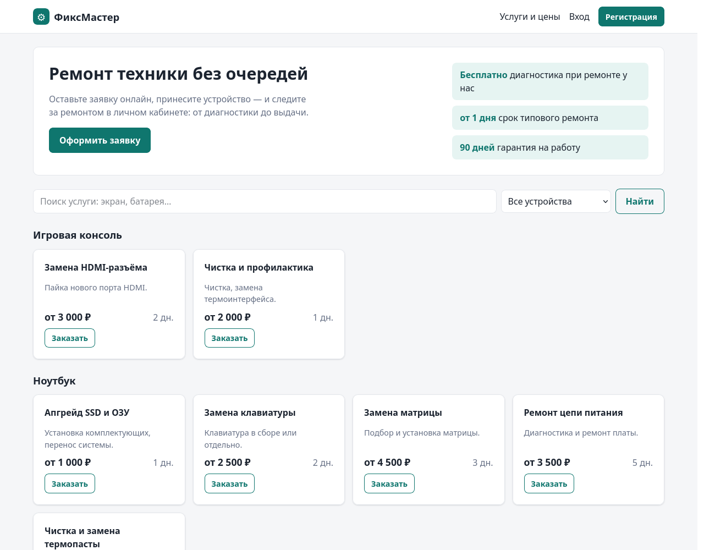

**Регистрация и вход.** «Регистрация» в шапке: логин, имя, фамилия, e-mail, телефон, пароль (не короче 8
символов, не только цифры).

**Новая заявка.** «Сдать в ремонт»: тип устройства, модель, серийный номер (необязательно), услуга (если не
знаете — оставьте пустой), описание неисправности и до 5 фото. После отправки откроется карточка заявки.

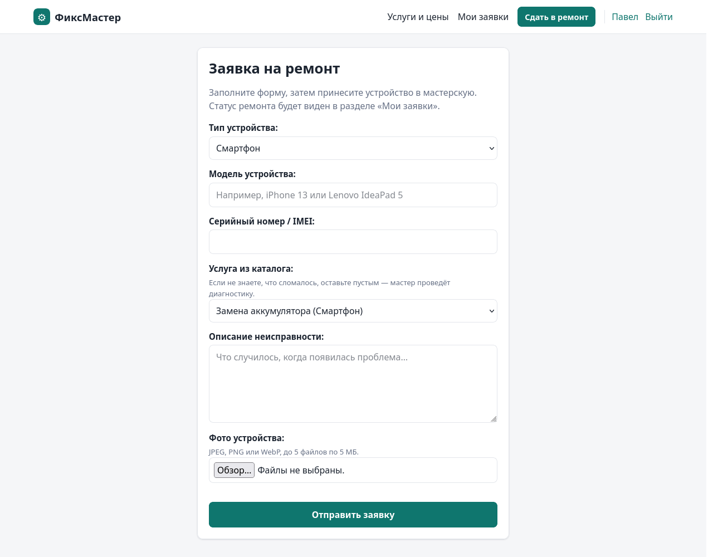

**Мои заявки.** Сверху активные заявки со статусом, ниже — история выданных с итоговой суммой.

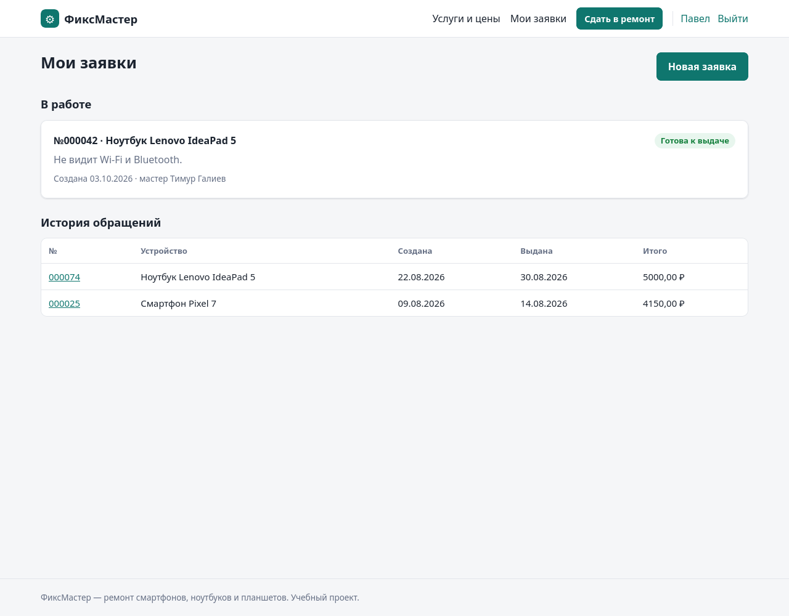

**Карточка заявки.** Шкала этапов ремонта, мастер, стоимость (работа + запчасти), история статусов,
переписка с мастером.

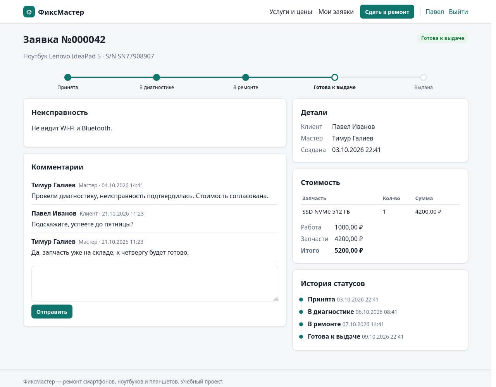

**Проверка без входа.** У каждой заявки есть код отслеживания. Страница `/requests/track/<код>/` показывает
только номер, устройство и этап — без личных данных. На эту ссылку будет вести QR-код квитанции.

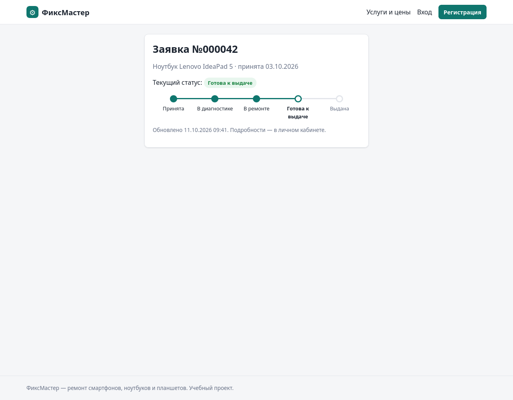

## 6.2. Мастер

**Мои ремонты.** Заявки, назначенные мастеру, с фильтром по статусу.

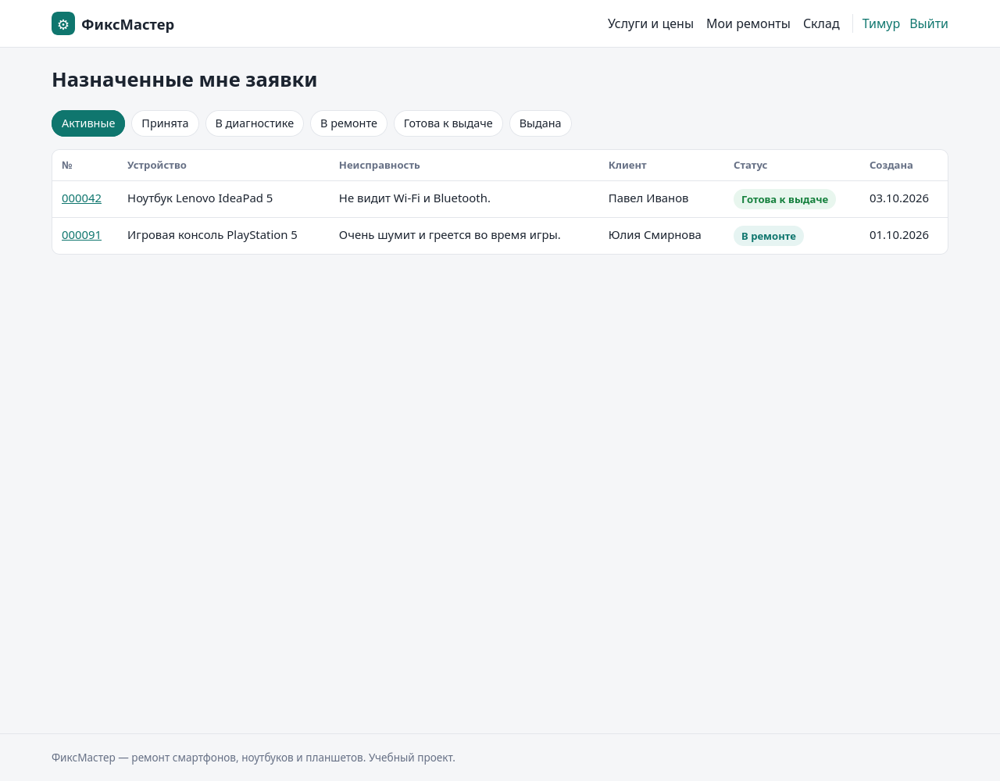

**Работа с заявкой.** В карточке мастер:

- меняет статус — в списке только допустимые следующие шаги;
- пишет комментарии; галочка «Только для сотрудников» скрывает комментарий от клиента;
- указывает стоимость работ;
- списывает запчасти со склада — сначала показываются подходящие к типу устройства; крестик возвращает
  запчасть на склад.

После статуса «Выдана» стоимость и запчасти менять нельзя.

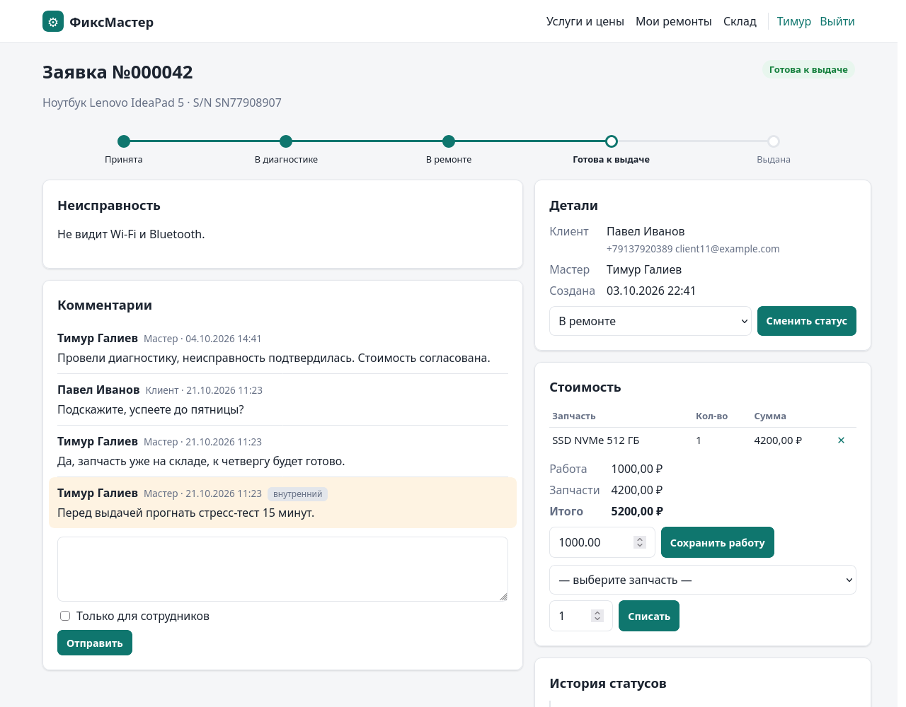

**Склад.** Мастер видит остатки, но не меняет их.

## 6.3. Администратор

**Заявки.** Все заявки с поиском (номер, модель, S/N, клиент, телефон) и фильтрами по статусу и мастеру.
«Не назначен» — заявки, которые ждут распределения. Мастер назначается в карточке заявки.

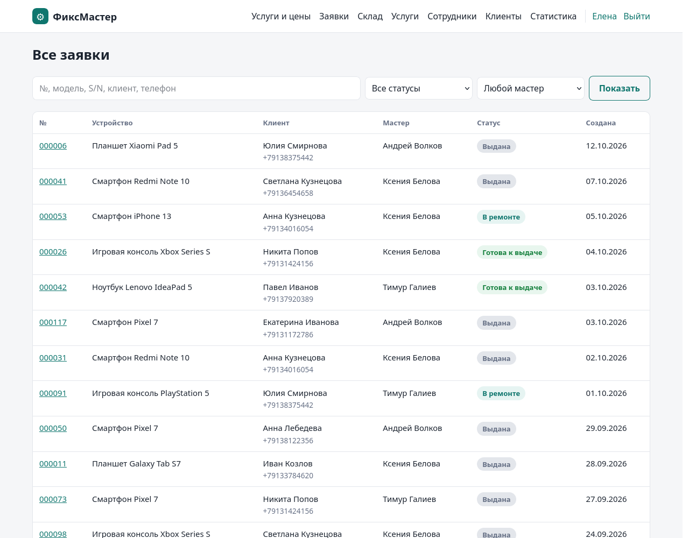

**Склад.** Карточки запчастей, фильтр «только заканчивающиеся» (остаток ≤ минимального). В карточке
запчасти — приход, инвентаризация (выставить фактический остаток с указанием причины) и последние движения.
«Журнал движений» показывает все операции склада.

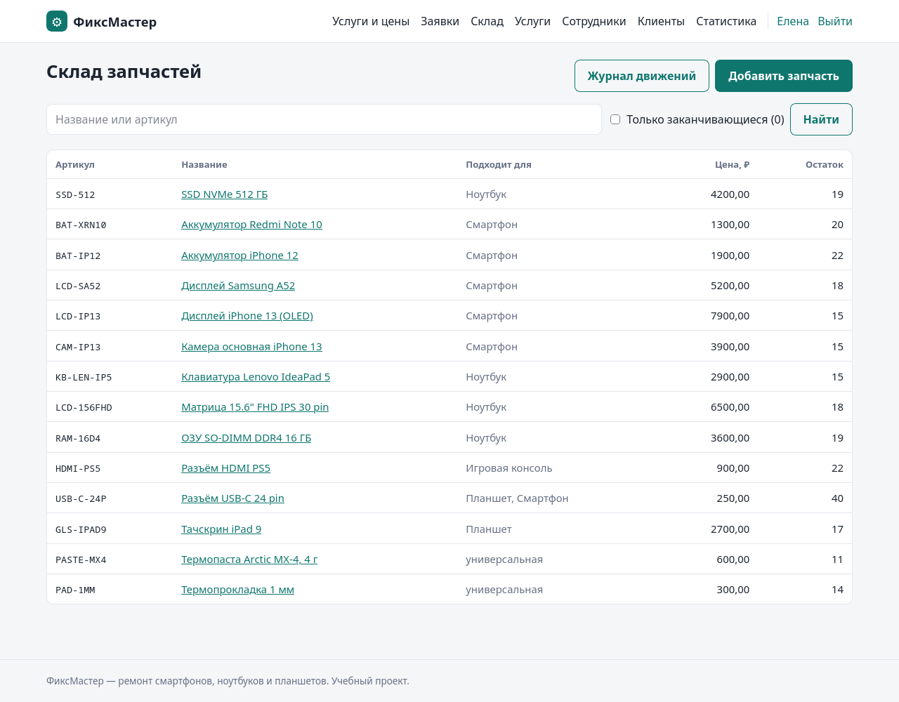

**Услуги.** Добавление и редактирование услуг. Снятая галочка «показывать в каталоге» скрывает услугу от
клиентов. Ниже — типы устройств.

**Сотрудники.** Создание мастеров и администраторов, смена роли, блокировка. Свою учётную запись
заблокировать или понизить нельзя.

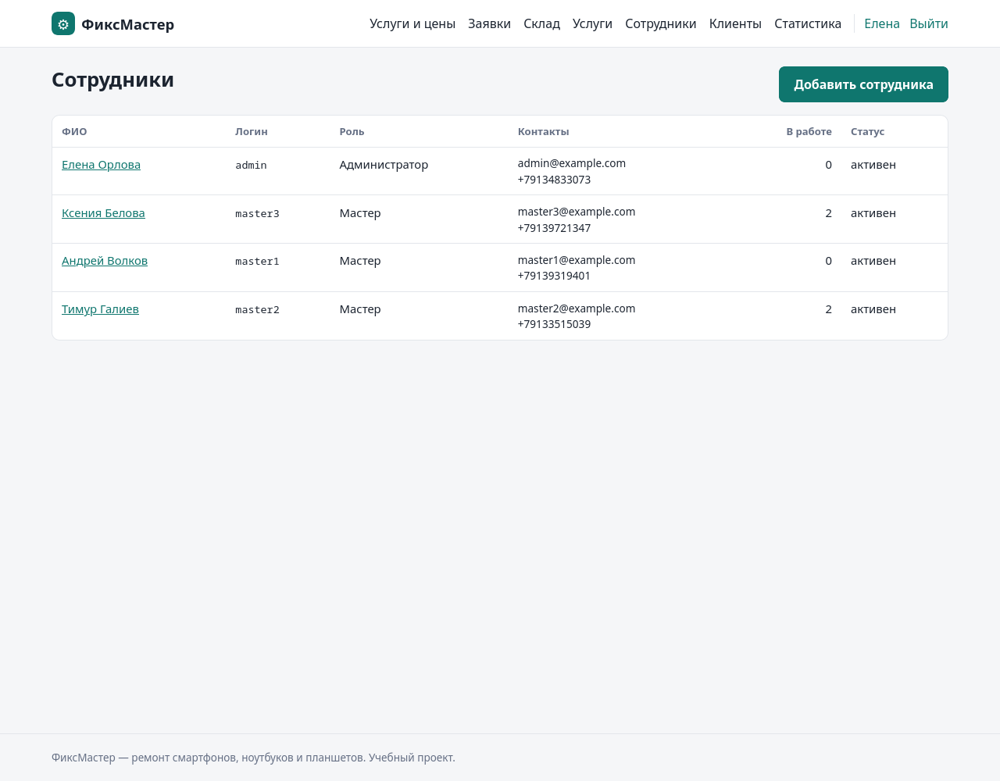

**Клиенты.** Список с количеством заявок; блокировка запрещает вход.

**Статистика.** Показатели (в работе, ждут выдачи, без мастера, доход за месяц, средний срок ремонта) и
графики: заявки и доход по месяцам, популярные неисправности, загрузка мастеров, устройства, статусы. Доход
считается по выданным заявкам: работа + запчасти.

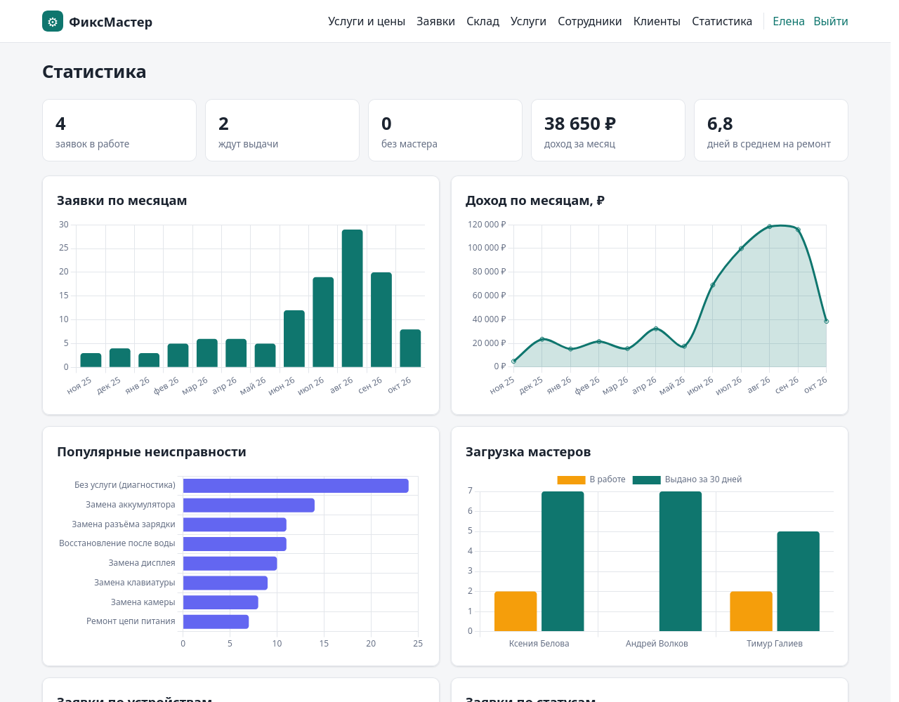

## 6.4. Мобильная версия

На узком экране меню сворачивается в кнопку ☰, колонки встают друг под другом.

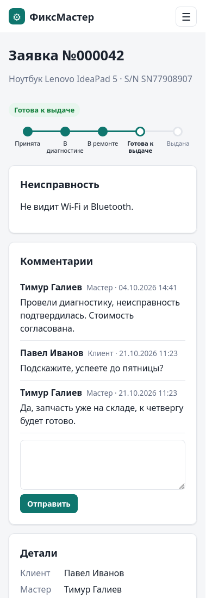
